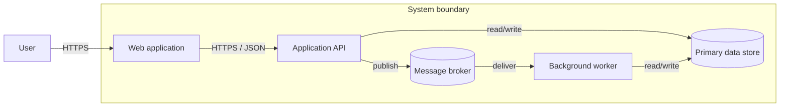
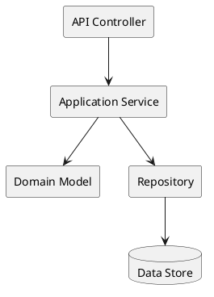
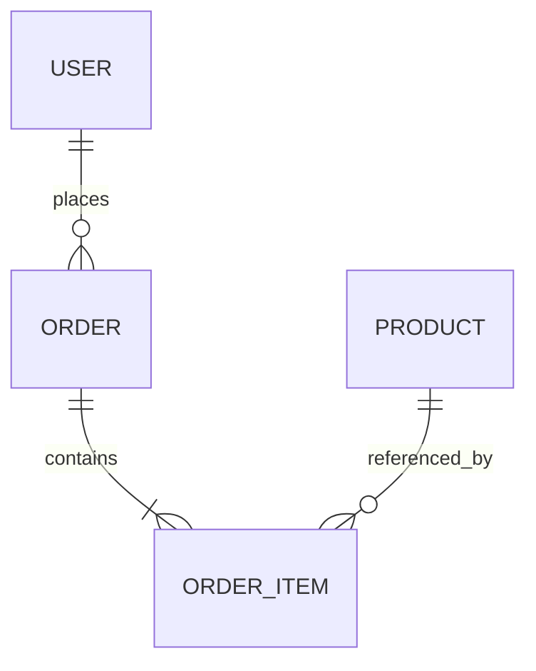
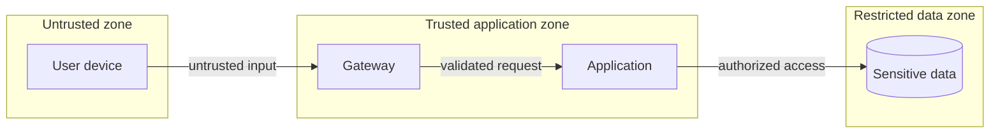

# System Architecture Document Template

> Use this document to explain the architecture, the decisions behind it, and how the system satisfies its functional and quality requirements. The structure is inspired by arc42, complemented with C4 views, architecture decision records, threat modeling, and operational readiness.

## 0. Document Control

| Field | Value |
|---|---|
| System | `<name>` |
| Architecture owner | `<name and role>` |
| Status | `Draft / In review / Approved / Superseded` |
| Version | `<x.y>` |
| Last updated | `<YYYY-MM-DD>` |
| Reviewers / approvers | `<names and roles>` |
| Product brief | `<link>` |
| Feature specifications | `<links>` |
| ADR repository | `<link>` |

## 1. Introduction and Goals

### 1.1 Purpose

`<State what this architecture document covers and the decisions it is intended to support.>`

### 1.2 System Overview

`<Briefly describe the system, its users, business purpose, and major capabilities.>`

## 2. Constraints

| ID | Category | Constraint | Source | Architectural consequence |
|---|---|---|---|---|
| CON-001 | `Technical / Organizational / Legal / Financial / Schedule` | `<constraint>` | `<source>` | `<consequence>` |

## 3. Solution Strategy

### 3.1 Strategy Summary

`<Summarize the fundamental approach, architecture style, decomposition strategy, integration style, data strategy, security strategy, and deployment model.>`

### 3.2 Key Technology Choices

| Concern | Choice | Why | Alternatives considered | ADR |
|---|---|---|---|---|
| `<concern>` | `<choice>` | `<drivers and trade-offs>` | `<alternatives>` | `<ADR link>` |

### 3.3 Architecture Principles

1. `<principle and implication>`
2. `<principle and implication>`
3. `<principle and implication>`

## 4. Building Block View

### 4.1 C4 Container View

### 4.2 Building Block Catalog

| ID | Building block | Type | Responsibility | Interfaces | Data owned | Technology | Owner |
|---|---|---|---|---|---|---|---|
| BB-001 | `<name>` | `Application / Service / Component / Data store` | `<responsibility>` | `<interfaces>` | `<data>` | `<technology>` | `<team>` |

### 4.3 Component View for `<Container>`

## 5. Data Architecture

### 5.1 Data Model

## 6. Cross-Cutting Concepts

### 6.3 Threat Model

| ID | Asset / flow | Threat | Existing control | Residual risk | Action | Owner |
|---|---|---|---|---|---|---|
| TM-001 | `<asset>` | `<STRIDE or other threat>` | `<control>` | `<rating>` | `<action>` | `<owner>` |

### 6.6 Resilience

| Dependency / failure mode | Timeout | Retry | Circuit breaker | Fallback | Recovery objective | Test |
|---|---|---|---|---|---|---|
| `<dependency>` | `<value>` | `<policy>` | `<policy>` | `<behavior>` | `<RTO/RPO or SLO>` | `<test>` |

## 7. References

### Primary references

- arc42, architecture documentation and communication template: https://arc42.org/
- arc42 section guidance: https://docs.arc42.org/home/
- C4 model, hierarchical architecture abstractions and diagrams: https://c4model.com/
- ISO/IEC/IEEE 29148:2018, requirements engineering: https://www.iso.org/standard/72089.html
- NIST SP 800-218, Secure Software Development Framework 1.1: https://csrc.nist.gov/pubs/sp/800/218/final
- OWASP Application Security Verification Standard: https://owasp.org/www-project-application-security-verification-standard
- W3C Web Content Accessibility Guidelines 2.2: https://www.w3.org/TR/WCAG22/
- Mermaid diagram syntax: https://mermaid.ai/open-source/intro/syntax-reference.html
- PlantUML documentation: https://plantuml.com/

### Tailoring note

This template is an original synthesis. It adopts the concerns and view-based approach promoted by the cited references, but it is not an official arc42, ISO, NIST, OWASP, W3C, C4, Mermaid, or PlantUML artifact. Tailor depth to system risk and complexity.