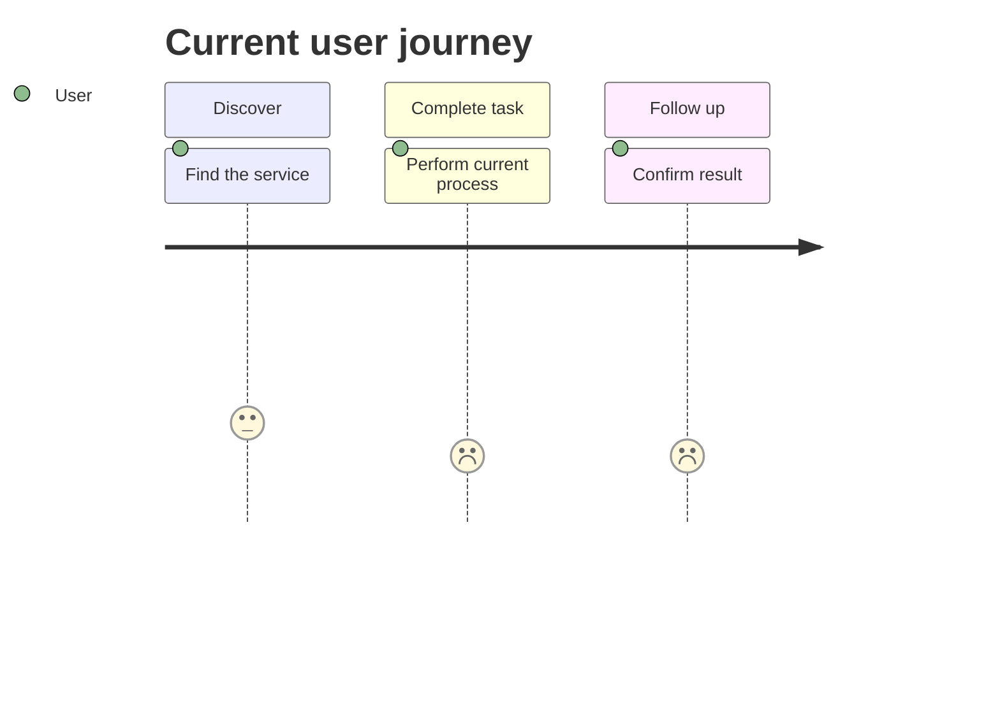
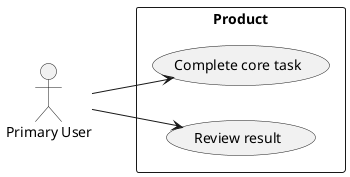

# Product Design Brief Template

> Use this document during discovery and early design. Keep it as a living artifact. Replace all `<placeholder>` text, remove sections that do not apply, and link detailed architecture or feature specifications rather than duplicating them.

## 0. Document Control

| Field | Value |
|---|---|
| Product / project | `<name>` |
| Document owner | `<name and role>` |
| Contributors | `<names and roles>` |
| Status | `Draft / In review / Approved / Superseded` |
| Version | `<x.y>` |
| Last updated | `<YYYY-MM-DD>` |
| Reviewers / approvers | `<names and roles>` |
| Related artifacts | `<links to roadmap, architecture, feature specs, ADRs>` |

## 1. Executive Summary

### 1.1 Product Idea

`<Describe the product in 2 to 4 sentences: who it serves, the problem it solves, and the intended value.>`

### 1.2 One-Line Value Proposition

**For** `<target user>` **who** `<need or problem>`, **the** `<product>` **is a** `<category>` **that** `<primary benefit>`. **Unlike** `<alternative>`, **it** `<key differentiator>`.

## 2. Problem and Opportunity

### 2.1 Problem Statement

`<Who experiences the problem, what happens, in which context, and why it matters. Avoid embedding a preferred solution.>`

### 2.2 Existing Journey and Pain Points

| Journey step | User goal | Current action | Pain point | Opportunity |
|---|---|---|---|---|
| `<step>` | `<goal>` | `<action>` | `<pain>` | `<opportunity>` |

## 3. Users and Stakeholders

### 3.1 Persona: `<Persona Name>`

> Personas must be grounded in research. Note whether each statement is observed, inferred, or assumed.

- **Archetype / role:** `<role>`
- **Context:** `<environment, device, workflow, frequency>`
- **Goals:** `<goals>`
- **Behaviors:** `<relevant observed behaviors>`
- **Pain points:** `<pain points>`
- **Motivations:** `<motivations>`
- **Constraints:** `<accessibility, time, policy, skill, connectivity>`
- **Current workaround:** `<how the problem is handled today>`
- **Evidence:** `<research references>`
- **Confidence:** `Low / Medium / High`

### 3.2 Jobs to Be Done

**When** `<situation>`, **I want to** `<motivation or job>`, **so I can** `<expected outcome>`.

### 3.3 Primary Use Cases

| Use Case ID | Actor | Trigger | Preconditions | Main outcome | Priority |
|---|---|---|---|---|---|
| UC-001 | `<actor>` | `<trigger>` | `<preconditions>` | `<outcome>` | `Must / Should / Could / Won't now` |

## 4. Functional Requirements

Write requirements as singular, necessary, implementation-neutral statements. Give each requirement a stable identifier and a verification method.

| ID | Requirement | Rationale / source | Priority | Verification | Related use case | Status |
|---|---|---|---|---|---|---|
| FR-001 | The system shall `<observable capability>`. | `<source>` | `Must / Should / Could` | `<test, inspection, analysis, demo>` | `UC-001` | `Proposed / Approved / Implemented / Verified` |

## 5. Non-Functional and Quality Requirements

Use measurable quality scenarios where possible. Replace words such as "fast," "secure," and "scalable" with testable thresholds.

| ID | Quality attribute | Scenario / requirement | Measure and target | Operating conditions | Verification | Priority |
|---|---|---|---|---|---|---|
| NFR-001 | Performance | When `<stimulus>`, the system shall `<response>`. | `<metric and threshold>` | `<normal / peak / degraded>` | `<load test>` | `<priority>` |
| NFR-002 | Availability | `<requirement>` | `<SLO / recovery target>` | `<conditions>` | `<monitoring / exercise>` | `<priority>` |
| NFR-003 | Security | `<requirement>` | `<control or verification target>` | `<threat context>` | `<security test>` | `<priority>` |
| NFR-004 | Accessibility | `<requirement>` | `<WCAG 2.2 conformance target>` | `<supported experiences>` | `<automated and manual audit>` | `<priority>` |
| NFR-005 | Privacy | `<requirement>` | `<data minimization / retention / consent target>` | `<jurisdiction / policy>` | `<review / test>` | `<priority>` |
| NFR-006 | Reliability | `<requirement>` | `<error rate / recovery target>` | `<conditions>` | `<resilience test>` | `<priority>` |
| NFR-007 | Observability | `<requirement>` | `<logs, metrics, traces, alert target>` | `<environment>` | `<operational test>` | `<priority>` |
| NFR-008 | Maintainability | `<requirement>` | `<quality gate / change metric>` | `<codebase context>` | `<pipeline evidence>` | `<priority>` |
| NFR-009 | Compatibility | `<requirement>` | `<browser, device, API version target>` | `<support matrix>` | `<compatibility test>` | `<priority>` |
| NFR-010 | Cost / sustainability | `<requirement>` | `<budget or utilization target>` | `<anticipated load>` | `<cost review>` | `<priority>` |

## 6. Initial System Context and Diagrams

### 6.1 Optional UML Use-Case Skeleton

## 7. Security, Privacy, Compliance, and Responsible Use

### 7.1 Threat and Abuse Cases

| ID | Threat / misuse case | Asset | Threat actor | Impact | Mitigation idea | Validation |
|---|---|---|---|---|---|---|
| THR-001 | `<threat>` | `<asset>` | `<actor>` | `<impact>` | `<mitigation>` | `<test / review>` |

## 8. Risks and Open Questions

### 8.1 Risk Register

| ID | Risk | Likelihood | Impact | Mitigation | Trigger | Owner |
|---|---|---|---|---|---|---|
| RSK-001 | `<risk>` | `Low / Medium / High` | `Low / Medium / High` | `<mitigation>` | `<indicator>` | `<owner>` |

## 9. References

### Standards and primary guidance

- ISO/IEC/IEEE 29148:2018, requirements engineering processes, information items, required content, and formatting guidance: https://www.iso.org/standard/72089.html
- W3C Web Content Accessibility Guidelines 2.2, testable accessibility success criteria: https://www.w3.org/TR/WCAG22/
- NIST SP 800-218, Secure Software Development Framework 1.1: https://csrc.nist.gov/pubs/sp/800/218/final
- OWASP Application Security Verification Standard: https://owasp.org/www-project-application-security-verification-standard
- C4 model, system context and architecture diagram hierarchy: https://c4model.com/
- Mermaid diagram syntax: https://mermaid.ai/open-source/intro/syntax-reference.html
- PlantUML documentation: https://plantuml.com/

### Tailoring note

This template is an original synthesis. It is informed by the references above, but it is not an official reproduction of any standard and does not by itself establish compliance.