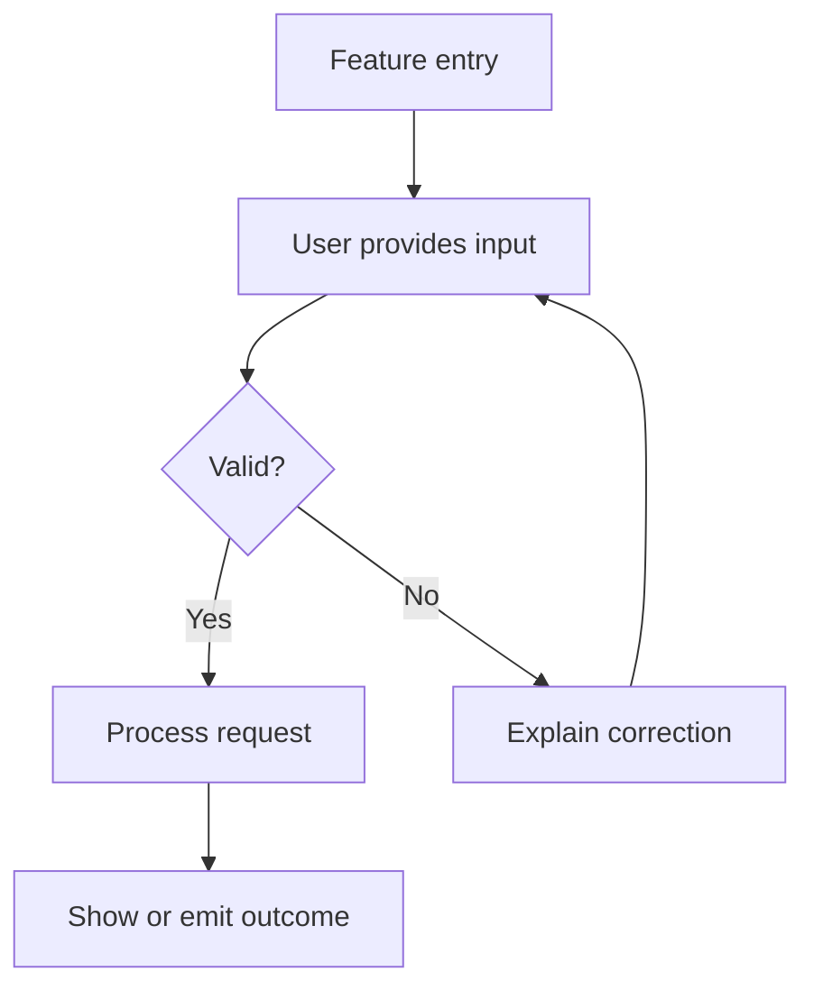
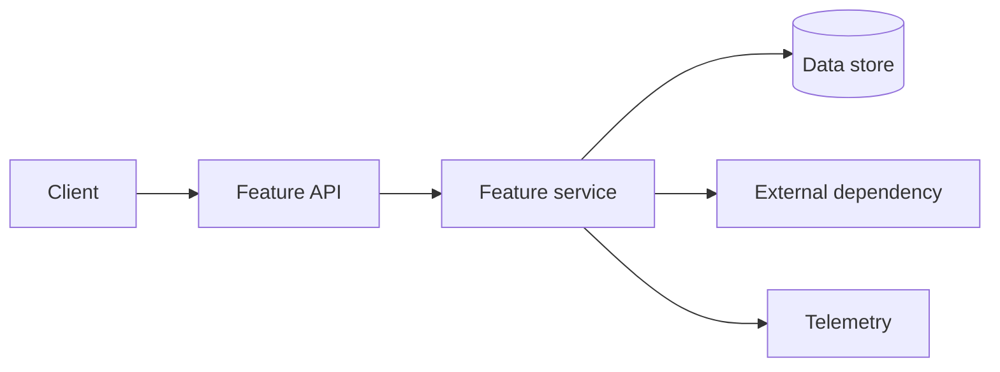
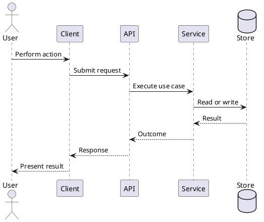
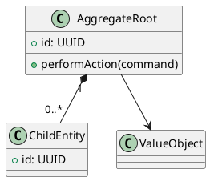
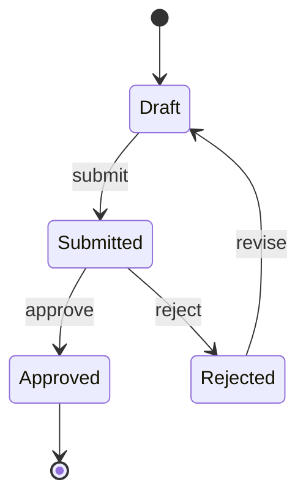

# Feature Specification Template

> Use one file per meaningful feature. The specification should be small enough to review and detailed enough for product, engineering, design, security, and testing to reach the same interpretation. Requirements and acceptance criteria should describe observable behavior, not hidden implementation, unless the implementation constraint is itself required.

## 0. Document Control

| Field | Value |
|---|---|
| Feature ID | `<FEAT-XXX>` |
| Feature name | `<name>` |
| Product / system | `<name>` |
| Owner | `<product owner / analyst>` |
| Status | `Discovery / Draft / Ready / In progress / Released / Deprecated` |
| Version | `<x.y>` |
| Last updated | `<YYYY-MM-DD>` |
| Target release | `<release or milestone, not a promise>` |
| Product brief | `<link>` |
| Architecture | `<link>` |

## 1. Summary

### 1.1 Feature Statement

**As a** `<persona or actor>`, **I want** `<capability>`, **so that** `<outcome>`.

## 2. Actors, Permissions, and Preconditions

| Actor / role | Goal | Required permission | Preconditions | Data access |
|---|---|---|---|---|
| `<actor>` | `<goal>` | `<permission>` | `<precondition>` | `<scope>` |

## 3. User Experience

### 3.1 Entry Points

- `<navigation, deep link, API call, event, scheduled trigger>`

### 3.2 Main User Flow



## 4. Functional Behavior

### 4.1 Input Rules

| Input | Type / format | Required | Validation | Default | Sensitive? | Error message |
|---|---|---|---|---|---|---|
| `<field>` | `<type>` | `Yes / No` | `<rules>` | `<default>` | `Yes / No` | `<message>` |

### 4.2 Output Rules

| Output | Format | Audience / consumer | Data source | Ordering / paging | Empty behavior |
|---|---|---|---|---|---|
| `<output>` | `<format>` | `<consumer>` | `<source>` | `<rules>` | `<behavior>` |

## 5. Acceptance Criteria

Use concrete, independently testable scenarios. Include happy paths, boundaries, errors, permissions, concurrency, and recovery where relevant.

### 5.1 Gherkin Scenarios

```gherkin
Feature: <Feature name>
  <Short description and important business rules>

  Background:
    Given <shared context only when it applies to every scenario>

  Rule: <Business rule>

    Scenario: <Happy path with a specific outcome>
      Given <initial state>
      And <additional context>
      When <single meaningful action>
      Then <observable outcome>
      And <additional observable outcome>

    Scenario: <Validation or boundary behavior>
      Given <initial state>
      When <action with invalid or boundary input>
      Then <specific safe response>
      And <state that must not change>

    Scenario Outline: <Data-driven behavior>
      Given <context using <parameter>>
      When <action using <parameter>>
      Then <expected <result>>

      Examples:
        | parameter | result |
        | <value>   | <value> |
```

## 6. Technical Design

### 6.1 Technical Summary

`<Describe the implementation approach at the level necessary for review. Link to an ADR for significant choices.>`

### 6.2 Block Diagram



### 6.3 Sequence Diagram



### 6.4 Class / Domain Model



### 6.5 State Model



### 6.6 Data Changes

| Entity / table | Change | Field | Type | Nullability | Default | Migration / backfill | Retention impact |
|---|---|---|---|---|---|---|---|
| `<entity>` | `Add / Modify / Remove` | `<field>` | `<type>` | `<rule>` | `<default>` | `<plan>` | `<impact>` |

### 6.7 API Contract

| Operation | Method / event | Path / topic | Authorization | Request schema | Response / event | Errors | Idempotency |
|---|---|---|---|---|---|---|---|
| `<operation>` | `<method>` | `<path>` | `<policy>` | `<link>` | `<link>` | `<codes>` | `<key / behavior>` |

Example skeleton:

```yaml
openapi: 3.1.0
info:
  title: <Feature API>
  version: 0.1.0
paths:
  /resources:
    post:
      operationId: createResource
      responses:
        '201':
          description: Created
        '400':
          description: Invalid request
        '401':
          description: Unauthenticated
        '403':
          description: Forbidden
        '409':
          description: Conflict
```

### 6.8 Events and Messaging

| Event | Producer | Consumer | Trigger | Schema | Delivery semantics | Ordering | Retry / dead letter |
|---|---|---|---|---|---|---|---|
| `<event>` | `<producer>` | `<consumer>` | `<trigger>` | `<link>` | `<at-least-once, etc.>` | `<guarantee>` | `<policy>` |

## 7. Security, Privacy, and Abuse Resistance

### 7.1 Security Requirements

| ID | Risk / requirement | Control | Verification | Reference |
|---|---|---|---|---|
| SEC-001 | `<risk or requirement>` | `<control>` | `<test / review>` | `<OWASP ASVS / policy ID>` |

### 7.2 Authorization Matrix

| Action | Role A | Role B | Service identity | Audit event |
|---|---|---|---|---|
| `<action>` | `Allow / Deny / Conditional` | `<value>` | `<value>` | `<event>` |

### 7.3 Threat and Misuse Cases

| ID | Misuse / threat | Preconditions | Impact | Prevention | Detection | Response |
|---|---|---|---|---|---|---|
| THR-001 | `<threat>` | `<conditions>` | `<impact>` | `<control>` | `<signal>` | `<response>` |

## 8. Failure, Recovery, and Compatibility

| Scenario | Expected behavior | User message | Retry / recovery | Data guarantee | Test |
|---|---|---|---|---|---|
| Dependency unavailable | `<behavior>` | `<safe message>` | `<policy>` | `<guarantee>` | `<test>` |
| Duplicate request | `<behavior>` | `<message>` | `<idempotency behavior>` | `<guarantee>` | `<test>` |
| Partial failure | `<behavior>` | `<message>` | `<compensation>` | `<guarantee>` | `<test>` |

### Backward Compatibility

- API / event compatibility: `<rules>`
- Data migration compatibility: `<rules>`
- Existing client behavior: `<rules>`
- Deprecation plan: `<plan>`

## 9. Dependencies, Risks, and Open Questions

### Dependencies

| ID | Dependency | Needed by | Owner | Failure impact | Contingency |
|---|---|---|---|---|---|
| DEP-001 | `<dependency>` | `<milestone>` | `<owner>` | `<impact>` | `<contingency>` |

### Risks

| ID | Risk | Likelihood | Impact | Mitigation | Trigger | Owner |
|---|---|---|---|---|---|---|
| RSK-001 | `<risk>` | `<rating>` | `<rating>` | `<mitigation>` | `<trigger>` | `<owner>` |

## 10. References

### Primary references

- ISO/IEC/IEEE 29148:2018, requirements engineering and requirement information items: https://www.iso.org/standard/72089.html
- Cucumber Gherkin reference, executable specification keywords and structure: https://cucumber.io/docs/gherkin/reference/
- C4 model, architecture diagram hierarchy: https://c4model.com/
- OWASP Application Security Verification Standard: https://owasp.org/www-project-application-security-verification-standard
- NIST SP 800-218, Secure Software Development Framework 1.1: https://csrc.nist.gov/pubs/sp/800/218/final
- W3C Web Content Accessibility Guidelines 2.2: https://www.w3.org/TR/WCAG22/
- Mermaid diagram syntax: https://mermaid.ai/open-source/intro/syntax-reference.html
- PlantUML documentation: https://plantuml.com/

### Tailoring note

This template is an original synthesis. It uses the cited references as authoritative anchors for requirements, acceptance criteria, architecture communication, secure development, accessibility, and diagrams as code. It is not itself a compliance standard.